# Mô hình dữ liệu

Đối chiếu mã nguồn ngày 22/11/2026, commit `1598cc754b3e95252fe61bcca8134cf6d0808fcc`. Tên định danh giữ nguyên theo Java; phần giải thích bằng tiếng Việt.

ERD logic đầy đủ **22 entity JPA**. Tên khối chính là class; thuộc tính giữ tên field Java, không tự đổi sang tên cột SQL. Bảng ánh xạ bên dưới nêu tên bảng vật lý. Các field tham chiếu có kiểu entity được đánh FK; JPA lưu ID của đối tượng, không lưu cả object. Đây là ánh xạ từ code, chưa phải kết quả truy vấn schema SQL Server đang chạy.

`Product` dùng `@Inheritance(strategy=InheritanceType.JOINED)`: ID của các bảng con đồng thời là PK/FK tới bảng cha. `ServiceItem` là entity trừu tượng có bảng riêng. Quan hệ cha → con là 1 → 0..1 cho từng loại; một Product cụ thể thuộc đúng một nhánh thực tế, không đồng thời mọi loại.

```mermaid
erDiagram
    Accessory {
        Long id PK,FK "kế thừa ID bảng cha"
        String brand
        Integer stockQuantity
        String category
    }
    Appointment {
        String seedKey
        Long id PK
        long version
        User customer FK
        String petName
        Species petSpecies "EnumType.STRING"
        ServiceItem service FK
        User staff FK
        LocalDateTime startTime
        LocalDateTime endTime
        String note
        BigDecimal price
        Subscription subscription FK
        boolean subscriptionUseRefunded
        BigDecimal discountAmount
        BigDecimal finalAmount
        AppointmentStatus stateName "EnumType.STRING"
    }
    Cart {
        Long id PK
        long version
        User customer FK
    }
    CartItem {
        Long id PK
        Cart cart FK
        Product product FK
        int quantity
    }
    GroomingService {
        Long id PK,FK "kế thừa ID bảng cha"
        BigDecimal petSizeSurcharge
    }
    HealthRecord {
        Long id PK
        OwnedPet ownedPet FK
        LocalDate date
        String type
        String description
        BigDecimal weight
        String vetName
    }
    LoyaltyAccount {
        Long id PK
        long version
        User customer FK
        long totalPoints
        long currentPoints
        MembershipTier tier "EnumType.STRING"
        boolean voucherAvailable
    }
    MonthlyCarePackage {
        Long id PK,FK "kế thừa ID bảng cha"
        Integer durationMonths
        Integer includedUses
        String includedServices
    }
    Order {
        Long id PK
        long version
        String seedKey
        User customer FK
        Subscription renewalSubscription FK
        BigDecimal totalAmount
        BigDecimal discountAmount
        BigDecimal finalAmount
        LocalDateTime createdAt
        String shippingAddress
        OrderStatus stateName "EnumType.STRING"
    }
    OrderItem {
        Long id PK
        Order order FK
        Product product FK
        int quantity
        BigDecimal unitPrice
        MonthlyCarePackage snapshotPackage FK
        Integer snapshotIncludedUses
        Integer snapshotDurationMonths
    }
    OwnedPet {
        Long id PK
        long version
        User owner FK
        String name
        Species species "EnumType.STRING"
        String breed
        LocalDate birthDate
        String gender
        String note
        String seedKey
    }
    Pet {
        Long id PK,FK "kế thừa ID bảng cha"
        Species species "EnumType.STRING"
        String breed
        Integer ageMonths
        String gender
        String size
        String healthNote
        PetStatus status "EnumType.STRING"
    }
    PetProfile {
        Long id PK
        long version
        Pet pet FK
        String seedKey
        int sizeLevel
        int energyLevel
        boolean childFriendly
        int sheddingLevel
        int spaceNeed
        int careCostLevel
        int experienceNeeded
        double timeNeedHoursPerDay
    }
    PointTransaction {
        Long id PK
        LoyaltyAccount account FK
        PointTransactionType type "EnumType.STRING"
        long points
        String description
        Order relatedOrder FK
        Appointment relatedAppointment FK
        LocalDateTime createdAt
        String sourceKey
    }
    Product {
        Long id PK
        long version
        String seedKey
        String name
        String description
        BigDecimal basePrice
        String imageUrl
        boolean active
        LocalDateTime createdAt
    }
    QuizResult {
        Long id PK
        User owner FK
        HomeSize homeSize "nhúng từ answers"
        Boolean hasChildren "nhúng từ answers"
        Integer activityLevel "nhúng từ answers"
        Double freeHoursPerDay "nhúng từ answers"
        Integer budgetLevel "nhúng từ answers"
        Boolean furAllergy "nhúng từ answers"
        Integer experienceLevel "nhúng từ answers"
        String strategyKey
        String strategyLabel
        LocalDateTime createdAt
    }
    ServiceItem {
        Long id PK,FK "kế thừa ID bảng cha"
        Integer durationMinutes
    }
    Subscription {
        Long id PK
        long version
        User customer FK
        OwnedPet ownedPet FK
        MonthlyCarePackage carePackage FK
        LocalDate startDate
        LocalDate endDate
        int remainingUses
        int totalUses
        boolean renewalPending
        SubscriptionStatus stateName "EnumType.STRING"
        String sourceKey
    }
    SubscriptionGrant {
        Long id PK,FK
        Order order FK
        Subscription subscription FK
    }
    User {
        Long id PK
        String fullName
        String email
        String password
        String phone
        Role role "EnumType.STRING"
        LocalDateTime createdAt
    }
    VaccinationRecord {
        Long id PK
        long version
        OwnedPet ownedPet FK
        String vaccineName
        LocalDate scheduledDate
        LocalDate administeredDate
        Integer annualDoseYear
        String note
        VaccinationStatus stateName "EnumType.STRING"
    }
    VetService {
        Long id PK,FK "kế thừa ID bảng cha"
        String doctorName
    }
    monthly_package_services {
        Long package_id PK,FK
        Long service_id PK,FK
    }
    subscription_services {
        Long subscription_id PK,FK
        Long service_id PK,FK
    }
    order_item_snapshot_services {
        Long order_item_id PK,FK
        Long service_id PK,FK
    }
    quiz_matches {
        Long quiz_id PK,FK
        int rank_index PK
        Long petId
        String petName
        double scorePercent
        String reasons
        String explanation
    }
    QuizResult ||--o{ quiz_matches : matches
    User ||--o{ Appointment : customer
    ServiceItem ||--o{ Appointment : service
    User ||--o{ Appointment : staff
    Subscription o|--o{ Appointment : subscription
    User ||--o| Cart : customer
    Cart ||--o{ CartItem : cart
    Product ||--o{ CartItem : product
    OwnedPet ||--o{ HealthRecord : ownedPet
    User ||--o| LoyaltyAccount : customer
    User ||--o{ Order : customer
    Subscription o|--o{ Order : renewalSubscription
    Order ||--o{ OrderItem : order
    Product ||--o{ OrderItem : product
    MonthlyCarePackage o|--o{ OrderItem : snapshotPackage
    User ||--o{ OwnedPet : owner
    Pet ||--o| PetProfile : pet
    LoyaltyAccount ||--o{ PointTransaction : account
    Order o|--o{ PointTransaction : relatedOrder
    Appointment o|--o{ PointTransaction : relatedAppointment
    User ||--o{ QuizResult : owner
    User ||--o{ Subscription : customer
    OwnedPet o|--o{ Subscription : ownedPet
    MonthlyCarePackage ||--o{ Subscription : carePackage
    Order ||--o| SubscriptionGrant : order
    Subscription ||--o{ SubscriptionGrant : subscription
    OwnedPet ||--o{ VaccinationRecord : ownedPet
    Product ||--o| Pet : JOINED
    Product ||--o| Accessory : JOINED
    Product ||--o| ServiceItem : JOINED
    ServiceItem ||--o| GroomingService : JOINED
    ServiceItem ||--o| VetService : JOINED
    ServiceItem ||--o| MonthlyCarePackage : JOINED
    MonthlyCarePackage ||--o{ monthly_package_services : chứa
    ServiceItem ||--o{ monthly_package_services : dịch_vụ
    Subscription ||--o{ subscription_services : chứa
    ServiceItem ||--o{ subscription_services : dịch_vụ
    OrderItem ||--o{ order_item_snapshot_services : chứa
    ServiceItem ||--o{ order_item_snapshot_services : dịch_vụ
```

## Ánh xạ entity → bảng

| Entity | Bảng khai báo bằng @Table |
| --- | --- |
| [Accessory:1](../src/main/java/com/petcare/domain/Accessory.java#L1) | `accessory_products` |
| [Appointment:1](../src/main/java/com/petcare/domain/Appointment.java#L1) | `appointments` |
| [Cart:1](../src/main/java/com/petcare/domain/Cart.java#L1) | `carts` |
| [CartItem:1](../src/main/java/com/petcare/domain/CartItem.java#L1) | `cart_items` |
| [GroomingService:1](../src/main/java/com/petcare/domain/GroomingService.java#L1) | `groomingservice_products` |
| [HealthRecord:1](../src/main/java/com/petcare/domain/HealthRecord.java#L1) | `health_records` |
| [LoyaltyAccount:1](../src/main/java/com/petcare/domain/LoyaltyAccount.java#L1) | `loyalty_accounts` |
| [MonthlyCarePackage:1](../src/main/java/com/petcare/domain/MonthlyCarePackage.java#L1) | `monthlycarepackage_products` |
| [Order:1](../src/main/java/com/petcare/domain/Order.java#L1) | `orders` |
| [OrderItem:1](../src/main/java/com/petcare/domain/OrderItem.java#L1) | `order_items` |
| [OwnedPet:1](../src/main/java/com/petcare/domain/OwnedPet.java#L1) | `owned_pets` |
| [Pet:1](../src/main/java/com/petcare/domain/Pet.java#L1) | `pet_products` |
| [PetProfile:1](../src/main/java/com/petcare/domain/PetProfile.java#L1) | `pet_profiles` |
| [PointTransaction:1](../src/main/java/com/petcare/domain/PointTransaction.java#L1) | `point_transactions` |
| [Product:1](../src/main/java/com/petcare/domain/Product.java#L1) | `products` |
| [QuizResult:1](../src/main/java/com/petcare/domain/QuizResult.java#L1) | `quiz_results` |
| [ServiceItem:1](../src/main/java/com/petcare/domain/ServiceItem.java#L1) | `service_items` |
| [Subscription:1](../src/main/java/com/petcare/domain/Subscription.java#L1) | `subscriptions` |
| [SubscriptionGrant:1](../src/main/java/com/petcare/domain/SubscriptionGrant.java#L1) | `subscription_grants` |
| [User:1](../src/main/java/com/petcare/domain/User.java#L1) | `users` |
| [VaccinationRecord:1](../src/main/java/com/petcare/domain/VaccinationRecord.java#L1) | `vaccination_records` |
| [VetService:1](../src/main/java/com/petcare/domain/VetService.java#L1) | `vetservice_products` |

## Cột trạng thái và cấu trúc bổ sung

- `Order.stateName`, `Appointment.stateName`, `VaccinationRecord.stateName`, `Subscription.stateName` và `Pet.status` dùng `@Enumerated(EnumType.STRING)`: lưu chữ như PENDING, BOOKED, SCHEDULED, ACTIVE, AVAILABLE; không lưu ordinal và không lưu object State. Tên cột mặc định theo naming strategy là `state_name` hoặc `status`.
- `role`, `species`, `petSpecies`, `tier`, `PointTransaction.type` và `QuizAnswers.homeSize` cũng dùng enum dạng chữ. `hibernate.use_nationalized_character_data=true` yêu cầu ánh xạ chuỗi sang nvarchar trên SQL Server; cần kiểm tra schema cũ thực tế, vì cấu hình không chứng minh mọi cột đã được chuyển đổi.
- `QuizAnswers` là @Embeddable, bảy field nằm trong `quiz_results`, không có bảng/entity độc lập. `QuizMatchSnapshot` là @Embeddable trong @ElementCollection: bảng `quiz_matches`, có `quiz_id` và `rank_index`. `petId` chỉ là giá trị chụp lịch sử, **không có quan hệ JPA/FK tới Pet**.
- Ba bảng nối Set là `monthly_package_services`, `subscription_services`, `order_item_snapshot_services`; cặp ID biểu diễn khóa ghép của tập quan hệ. Không nhầm các bảng nối với entity Java.
- `OrderItem` chụp `unitPrice`, `snapshotPackage`, `snapshotIncludedUses`, `snapshotDurationMonths`, `snapshotServices`; `Subscription` giữ `coveredServices`, số lượt và thời hạn đã cấp. Snapshot lưu tập tham chiếu dịch vụ, không sao chép toàn bộ tên/thuộc tính của ServiceItem.
- `SubscriptionGrant.id` dùng @MapsId từ `order_id`; một đơn có tối đa một biên nhận, `subscription` trỏ gói đầu tiên của lô. Một đơn nhiều đơn vị có thể cấp nhiều Subscription qua sourceKey; không vẽ quan hệ trực tiếp Order → Subscription cho mua mới vì không có field đó.
- `Appointment.subscription` và `subscriptionUseRefunded` ghi nguồn lượt dùng/hoàn. `Appointment` chỉ có `petName`/`petSpecies`, **không FK tới OwnedPet**. `OwnedPet` độc lập với Pet bán trong danh mục; tạo từ đơn hoàn tất không thiết lập quan hệ bền vững tới Order/Pet.

## Ràng buộc đáng chú ý

`Cart.customer` duy nhất; cặp cart_id/product_id duy nhất. User.email, PetProfile.pet/seedKey, LoyaltyAccount.customer, PointTransaction.sourceKey, Subscription.sourceKey có ràng buộc duy nhất. Không suy diễn mọi seedKey đều UNIQUE: nhiều seed được bảo vệ bằng khóa và kiểm tra trong service. `@Version` có ở Product, Cart, Order, Appointment, OwnedPet, VaccinationRecord, PetProfile, LoyaltyAccount, Subscription. Ràng buộc CHECK giữ điểm không âm và 0 ≤ remainingUses ≤ totalUses.
Để xác minh SQL Server: xem bước kiểm tra thủ công trong [demo-script.md](demo-script.md).
