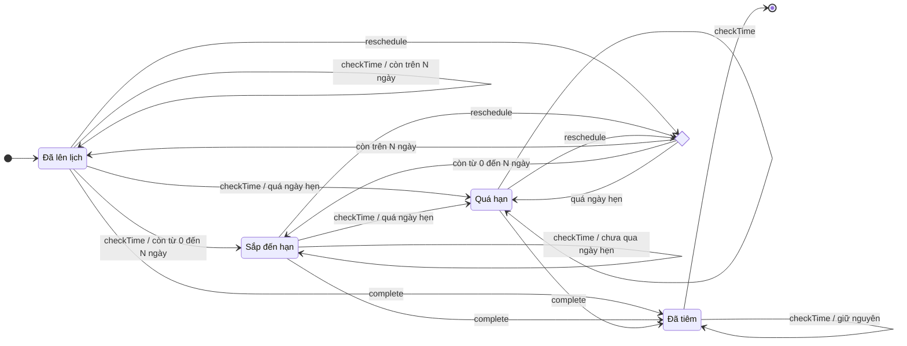

# Giai đoạn 5A — Sức khỏe và lịch tiêm phòng

## Phạm vi

Thêm `OwnedPet`, `HealthRecord`, `VaccinationRecord`, State, lịch mẫu, scheduler và Observer. Giữ nguyên các lớp, luồng mua hàng, lịch hẹn và giao diện của giai đoạn trước. Chưa có controller hoặc màn hình sức khỏe; GĐ5B sẽ bổ sung điều hướng cùng giao diện.

- `OwnedPet` thuộc một `User` CUSTOMER, lưu tên, loài, giống, ngày sinh, giới tính, ghi chú; độc lập với `Pet` là hàng để bán.
- `OwnedPet.fromCompletedOrder(order, pet, birthDate, today)` cho phép tạo hồ sơ từ đúng Pet trong đơn COMPLETED. Phải cung cấp ngày sinh được xác nhận vì Pet cũ chỉ có tuổi theo tháng. Đây là khả năng chuyển đổi chủ động ở domain, chưa tự động gắn vào `OrderService.complete` và chưa chống việc người gọi tạo hai hồ sơ độc lập từ cùng Pet.
- Dùng `OwnedPetService.register` khi thêm hồ sơ: kiểm tra đúng chủ đăng nhập, lưu OwnedPet và tự sinh/lưu lịch mẫu trong **cùng transaction**. Không gọi lại để sinh lịch cho hồ sơ đã có ID. Ghi trực tiếp bằng repository chỉ lưu entity, không kích hoạt lịch mẫu.
- `HealthRecord` lưu ngày, loại dạng chuỗi mô tả, mô tả chi tiết, cân nặng kg (nullable, lớn hơn 0, tối đa hai chữ số thập phân), tên bác sĩ. Ngày không được trước ngày sinh.
- `VaccinationRecord` có `@Version`, ngày hẹn, ngày đã tiêm nullable, ghi chú; DB lưu `state_name` bằng `EnumType.STRING`. `annual_dose_year` nullable lưu số năm của mũi nhắc kể từ mốc 12 tuần, không đổi khi đổi ngày hẹn. Không có setter để sửa ngày/trạng thái bỏ qua State. Factory dựng State khi cần, không lưu đối tượng State vào DB.

## Sơ đồ State



N mặc định 7, cấu hình được. **Đúng 7 ngày và đúng ngày hẹn là DUE_SOON; quá 1 ngày là OVERDUE.** Nếu ứng dụng ngừng chạy nhiều ngày, Scheduled có thể đi thẳng tới Overdue. Completed không cho `complete` lần hai hoặc `reschedule` và không đổi khi kiểm tra thời gian.

Các phương thức State trả quyết định giống cách Order/Appointment hiện có. Gọi hành vi qua `VaccinationRecord`: `checkTime(today, dueSoonDays)`, `complete(date, today)`, `reschedule(newDate, today, dueSoonDays)`. Khi đổi lịch, State xác nhận quyền và cho điểm bắt đầu SCHEDULED; hồ sơ lập tức dùng State này đánh giá ngày mới, chỉ áp dụng/phát sự kiện cho kết quả cuối. Không có trạng thái trung gian được lưu hoặc được thông báo.

Giả định nghiệp vụ:

- Cho phép hoàn tất từ cả ba State còn hiệu lực, kể cả tiêm sớm; ngày đã tiêm không trước ngày sinh và không ở tương lai.
- Cho phép đổi sang ngày quá khứ (nhưng không trước ngày sinh) để ghi nhận lịch hẹn bị bỏ lỡ; kết quả là OVERDUE.
- `checkTime` chỉ tiến về phía trước; Clock lùi hoặc giảm ngưỡng không tự hạ DUE_SOON/OVERDUE. Đổi lịch chủ động sẽ phân loại lại theo ngưỡng hiện tại.
- Ngày hiện tại truyền tường minh vào domain. Service và scheduler lấy `LocalDate.now(clock)` từ bean Clock hiện có (`AppointmentClockConfig`, múi giờ `Asia/Ho_Chi_Minh`); không thêm Clock hệ thống thứ hai.
- Hoàn tất hồ sơ đã lưu qua `VaccinationService.complete(id, date)` để cập nhật State và bổ sung mũi nhắc trong cùng giao dịch. STAFF/ADMIN được xác nhận đã tiêm; CUSTOMER bị từ chối. Gọi lại trên hồ sơ COMPLETED vẫn báo lỗi theo State cũ và không tạo thêm mũi.
- Mũi nhắc tiếp theo lấy từ ngày sinh + 12 tuần + số năm kế tiếp, không tính từ ngày tiêm thực tế hoặc ngày đã đổi hẹn. Mũi kế tiếp có thể quá hạn nếu hoàn tất rất trễ. Mũi cơ bản hoặc lịch nhập riêng có `annual_dose_year = NULL` không tự sinh mũi nhắc. Các mốc trong cùng chu kỳ không được dịch chuyển chỉ vì tiêm sớm/trễ; đây là giả định cho dữ liệu mẫu.

## Lịch mẫu và cấu hình

**Dữ liệu mẫu, không phải tư vấn thú y.** Chó và mèo có lịch minh họa 6, 8, 12 tuần tính từ `birthDate`; mũi nhắc hằng năm dùng `birthDate.plusWeeks(12).plusYears(n)`. Dùng năm lịch và mốc gốc cho từng năm, nên chu kỳ ngày 29/02 sẽ trở lại 29/02 khi tới năm nhuận.

Template nhận Clock inject và sinh N mũi nhắc **tương lai** kể từ hôm nay (N mặc định 3, cấu hình từ 1 đến 20). Thú cưng mới sinh vẫn có ba mũi cơ bản và N mũi nhắc như trước. Giả định khi đăng ký muộn: bỏ mũi cơ bản đã qua; chỉ thêm **một mũi nhắc hằng năm gần nhất đã đến hạn** nếu có, cộng N mũi tương lai. Không sinh lại hàng loạt mũi quá khứ hoặc giả định đã tiêm. Mũi gần nhất trước hôm nay là OVERDUE; đúng hôm nay là DUE_SOON. Nếu chưa đến mũi nhắc đầu tiên thì không có mũi nhắc quá hạn. Loài khác chưa có mẫu, trả danh sách rỗng.

Ví dụ đăng ký ngày 13/11/2026 cho thú cưng sinh 13/11/2021, N = 3: chỉ sinh các mũi 05/02/2026 (quá hạn), 05/02/2027, 05/02/2028, 05/02/2029. Hoàn tất mũi nhắc sẽ tự bổ sung năm kế tiếp nếu chưa tồn tại. Nhận diện mũi trùng bằng thú cưng + tên vaccine trong chu kỳ + `annual_dose_year`, nên mũi kế tiếp đã đổi ngày hoặc đã tiêm cũng không bị tạo lại.

| Property | Mặc định | Ý nghĩa |
|---|---|---|
| `petcare.vaccinations.due-soon-days` | `7` | Ngưỡng bao gồm ngày biên, từ 0 đến 365 ngày |
| `petcare.vaccinations.annual-booster-years` | `3` | Số mũi nhắc tương lai khi đăng ký, từ 1 đến 20; chưa tính mũi gần nhất đã tới hạn |
| `petcare.vaccinations.scheduler.enabled` | `true` | Bật/tắt bean scheduler và cấu hình lập lịch |
| `petcare.vaccinations.scheduler.cron` | `0 0 1 * * *` | Chạy 01:00 hằng ngày, múi giờ Việt Nam |

Scheduler chỉ truy vấn bản ghi khác COMPLETED, chụp ngày hiện tại một lần cho lượt chạy, gọi State rồi lưu các bản ghi có thay đổi trong transaction. Chạy lại cùng ngày không tăng version/phát lại sự kiện nếu State không đổi. Ngưỡng cấu hình áp dụng khi kiểm tra tiếp theo, không bị lưu cứng trên từng bản ghi. Profile `test` tắt tác vụ nền; test tích hợp bật bean và dùng cron `-` để gọi chủ động, không chờ thời gian thật.

## Observer và lưu dữ liệu

`VaccinationRecord` kế thừa `AbstractAggregateRoot` của Spring Data. Chuyển **sang** DUE_SOON hoặc OVERDUE đăng ký `VaccinationStatusChangedEvent` (Spring `ApplicationEvent`), bao gồm cả phân loại lần đầu và đổi lịch. Không phát khi State không đổi, về SCHEDULED hoặc sang COMPLETED.

Repository `save`/`saveAll` phát và xóa hàng đợi sự kiện; chỉ dựa vào JPA dirty checking sẽ không phát sự kiện. Scheduler, luồng đăng ký và service hoàn tất đều gọi save. Khi bổ sung giao diện ở GĐ5B, gọi các service để giữ đủ giao dịch, quyền truy cập và Clock/ngưỡng cấu hình tại biên service.

Luồng hoàn tất hiện có ở `VaccinationService`: chỉ đọc ID thú cưng trước khi khóa, khóa OwnedPet rồi VaccinationRecord bằng cơ chế `CommerceLocks` sẵn có; hoàn tất, kiểm tra mũi năm kế tiếp và lưu nếu thiếu. Khóa được giữ tới commit để hai yêu cầu không cùng tạo mũi; nếu lưu mũi kế tiếp lỗi thì rollback cả trạng thái hoàn tất. Không gọi domain `complete` rồi tự save từ giao diện vì sẽ bỏ qua bước bổ sung lịch của service. Scheduler không sinh mũi mới và không thay đổi nhiệm vụ ở giai đoạn này.

Listener dùng `@TransactionalEventListener` mặc định AFTER_COMMIT, ghi log tiếng Việt; rollback không tạo log thông báo sai. Sự kiện chụp trạng thái trước/sau, ngày hẹn, ngày kiểm tra, tên vaccine; ID đọc từ nguồn entity sau khi JPA cấp. Chưa có email, thông báo bền vững hoặc hàng đợi ngoài tiến trình. `@Version` ngăn ghi đè đồng thời; giai đoạn này chưa có cơ chế retry cho xung đột hoặc điều phối nhiều máy chạy scheduler.

## Kiểm thử và cách chạy

Yêu cầu Java 21 và Maven; không thêm thư viện hoặc đổi Spring Boot.

Kết quả sau sửa review: `mvn -B -ntp test` trên Java 21 đạt **283 test, 0 failure, 0 error, 0 skipped** (tăng 13 ca so với 270 test trước sửa). Lượt chạy cần ngoài sandbox vì sandbox Windows chặn named pipe của Mockito khi gắn Java agent; không sửa cấu hình build để bỏ qua test.

```powershell
mvn test
mvn test '-Dtest=VaccinationStateTest,VaccinationScheduleTemplateTest,PetHealthDomainTest,VaccinationSchedulerTest,VaccinationSchedulingConfigTest,PetHealthPersistenceTest'
```

Test bao phủ các State và quyền thao tác, mọi nhánh đổi lịch, ngày biên, dữ liệu ngày/cân nặng sai, Factory, template theo loài/năm nhuận, Clock cố định ở ranh giới UTC/Việt Nam, cấu hình bật/tắt/cron, lưu và dựng lại State trên H2, sinh lịch cùng giao dịch, sự kiện không lặp, snapshot sự kiện và listener sau commit/rollback. Các test cũ vẫn chạy trong bộ đầy đủ.

Sửa review bổ sung test thú cưng 5 tuổi có lịch tương lai nhưng không có hàng loạt lịch quá khứ; mũi đúng ngày hẹn; mũi năm sau chỉ tạo một lần, kể cả hai yêu cầu đồng thời; mũi năm sau đã đổi ngày; chu kỳ năm nhuận; lỗi lưu mũi năm sau rollback hoàn tất. Test quyền sở hữu đăng nhập CUSTOMER A nhưng truyền hồ sơ của B. Test rollback đăng ký gọi service **không có giao dịch bao ngoài**, lưu thật OwnedPet và một lịch tiêm rồi giả lập lỗi `saveAll`; giao dịch mới phải đọc được số bản ghi bằng 0.

## Tự kiểm tra SQL Server thật

Chưa kiểm chứng SQL Server thật vì không có thông tin đăng nhập. H2 chỉ được dùng cho test. Trên database phát triển, đặt `DB_URL`, `DB_USERNAME`, `DB_PASSWORD` bằng thông tin của bạn; không ghi mật khẩu vào code.

```powershell
mvn spring-boot:run '-Dspring-boot.run.profiles=demo'
```

1. Kiểm tra log khởi động không có lỗi tạo ba bảng `owned_pets`, `health_records`, `vaccination_records`, khóa ngoại, index và cột version. Kiểm tra lại các luồng mua hàng/đặt lịch cũ. Profile demo vẫn dùng SQL Server và các seeder cũ; GĐ5A chưa thêm seeder/giao diện sức khỏe.
2. Trong SSMS, chọn database phát triển và chạy bộ dữ liệu tối thiểu dưới đây **một lần**. `@today` phải là ngày hiện tại tại Việt Nam. Các dòng được ghi trực tiếp chỉ để kiểm thử scheduler, không kiểm thử tự sinh template (luồng đó đã có test tích hợp qua service).

```sql
DECLARE @today date = CAST(SYSDATETIMEOFFSET() AT TIME ZONE 'SE Asia Standard Time' AS date);
DECLARE @ownerId bigint = (SELECT TOP (1) id FROM users WHERE role = 'CUSTOMER' ORDER BY id);
IF @ownerId IS NULL THROW 50000, N'Cần có tài khoản CUSTOMER trước khi kiểm thử.', 1;

INSERT INTO owned_pets (owner_id, name, species, breed, birth_date, gender, note)
VALUES (@ownerId, N'Milo kiểm thử 5A', 'DOG', N'Giống mẫu', DATEADD(year, -1, @today), N'Đực', N'Dữ liệu kiểm thử');
DECLARE @petId bigint = SCOPE_IDENTITY();

INSERT INTO health_records (owned_pet_id, record_date, type, description, weight, vet_name)
VALUES (@petId, @today, N'Khám', N'Kiểm thử lưu Unicode và cân nặng', 4.25, N'Bác sĩ mẫu');

INSERT INTO vaccination_records (owned_pet_id, vaccine_name, scheduled_date, administered_date, note, state_name, version)
VALUES
(@petId, N'Mẫu còn 8 ngày', DATEADD(day, 8, @today), NULL, N'Kiểm thử', 'SCHEDULED', 0),
(@petId, N'Mẫu còn 7 ngày', DATEADD(day, 7, @today), NULL, N'Kiểm thử', 'SCHEDULED', 0),
(@petId, N'Mẫu đúng ngày', @today, NULL, N'Kiểm thử', 'SCHEDULED', 0),
(@petId, N'Mẫu quá 1 ngày', DATEADD(day, -1, @today), NULL, N'Kiểm thử', 'SCHEDULED', 0),
(@petId, N'Mẫu đã tiêm', DATEADD(day, -1, @today), @today, N'Kiểm thử', 'COMPLETED', 0);

SELECT id, vaccine_name, scheduled_date, administered_date, state_name, version
FROM vaccination_records WHERE owned_pet_id = @petId ORDER BY id;
```

3. Để không chờ tới 01:00, dừng ứng dụng rồi chạy tạm cron mỗi 10 giây:

```powershell
mvn spring-boot:run '-Dspring-boot.run.profiles=demo' '-Dspring-boot.run.arguments=--petcare.vaccinations.scheduler.cron="*/10 * * * * *"'
```

4. Đọc lại các dòng vừa thêm: lần lượt SCHEDULED, DUE_SOON, DUE_SOON, OVERDUE, COMPLETED. Log có ba lần chuyển sang sắp hạn/quá hạn; lượt chạy tiếp không lặp log, version không tăng tiếp, dòng COMPLETED giữ version 0 và ngày đã tiêm.
5. Dừng và chạy với `'-Dspring-boot.run.arguments=--petcare.vaccinations.scheduler.enabled=false'`; thêm một dòng SCHEDULED đã tới hạn bằng SQL, xác nhận không bị cập nhật sau 10 giây. Bật lại và kiểm tra tác vụ xử lý bù.
6. Thử cron ngắn cùng `--petcare.vaccinations.due-soon-days=10` trong run arguments; dòng còn 8 ngày sẽ sang DUE_SOON. Kết thúc kiểm tra bằng cách dừng lệnh thử và khởi động lại lệnh profile demo mặc định để trở về lịch hằng ngày.
7. Với DB đã chạy bản GĐ5A trước sửa, kiểm tra Hibernate thêm được cột `annual_dose_year` kiểu số nguyên, nullable. Hồ sơ cũ vẫn giữ nguyên; không suy ra mũi hằng năm chỉ từ tên. Trước khi dùng luồng hoàn tất cho lịch cũ, cần xác nhận và điền số năm của đúng chu kỳ; lịch không xác định vẫn để NULL. Không tự đánh dấu các lịch cũ là đã tiêm.
8. Trong phiên kiểm thử service/debug kết nối SQL Server, đăng ký thú cưng 5 tuổi qua `OwnedPetService.register` với phiên CUSTOMER: kiểm tra một mũi gần nhất đã tới hạn và N mũi tương lai. Dùng phiên STAFF/ADMIN gọi `VaccinationService.complete` cho một mũi hằng năm; kiểm tra năm kế tiếp đúng chu kỳ và không tăng số dòng khi gọi lại hoặc khi năm kế tiếp đã tồn tại. Không thay thế bước gọi service bằng SQL UPDATE State vì SQL bỏ qua logic sinh mũi mới. Kiểm tra hai yêu cầu đồng thời chỉ một yêu cầu hoàn tất thành công; SQL Server thật cần xác nhận hành vi khóa dù test H2 đã kiểm chứng logic.
