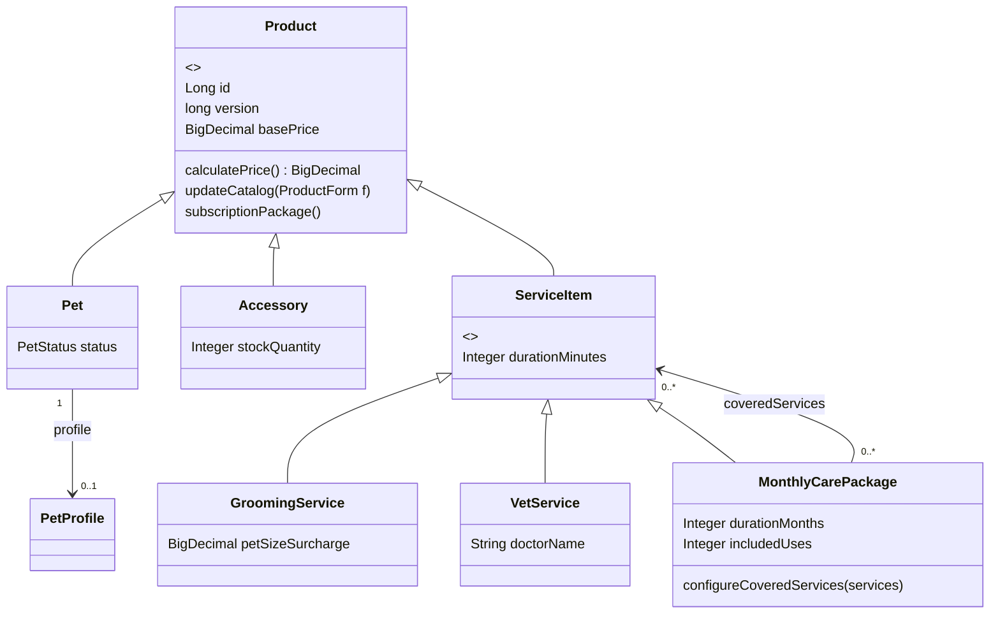
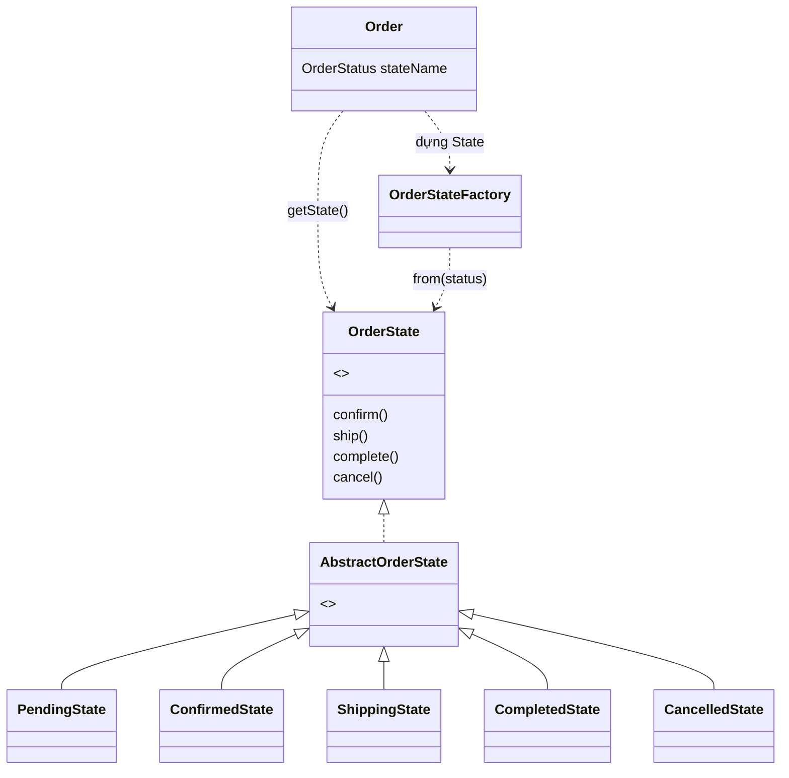
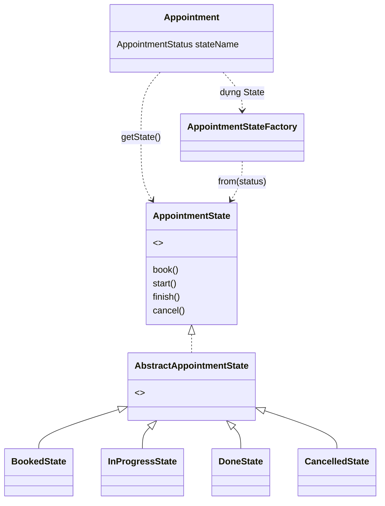
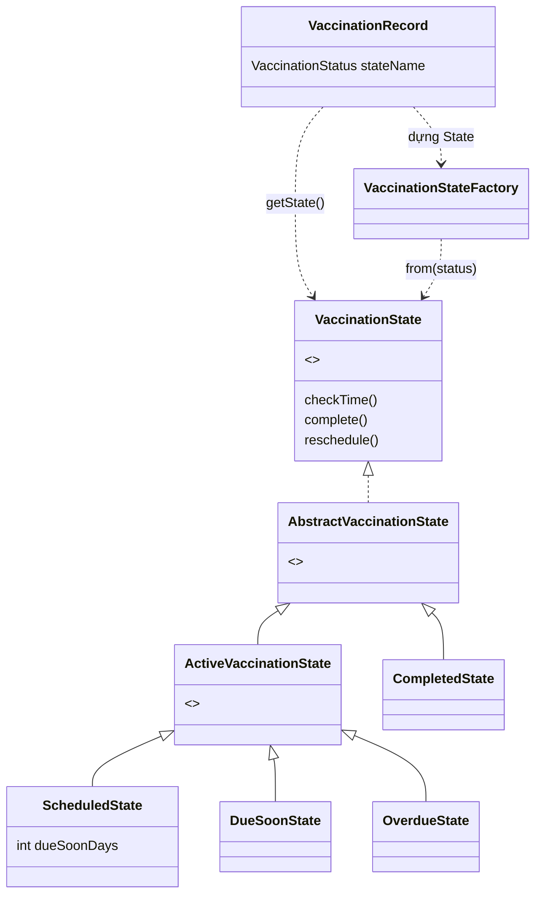
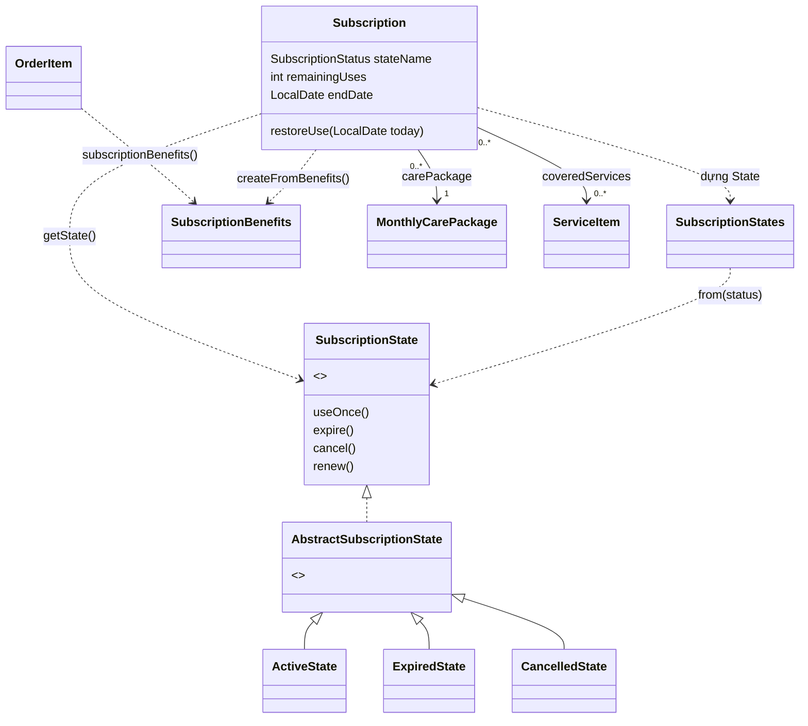
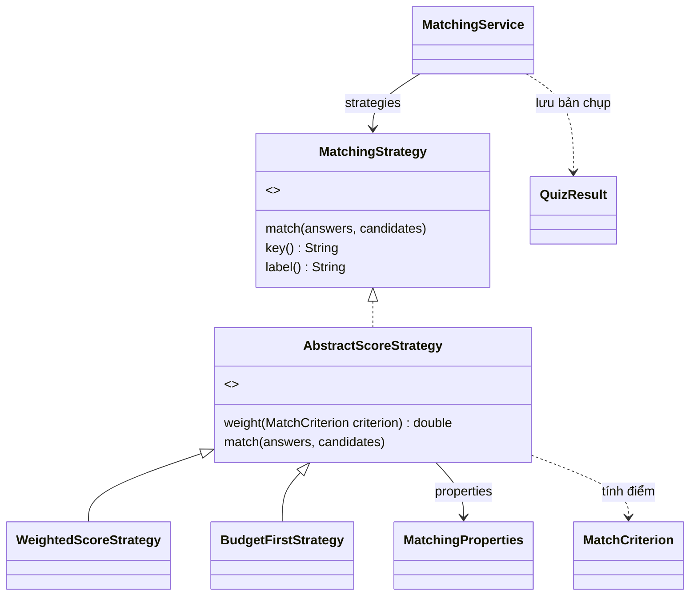
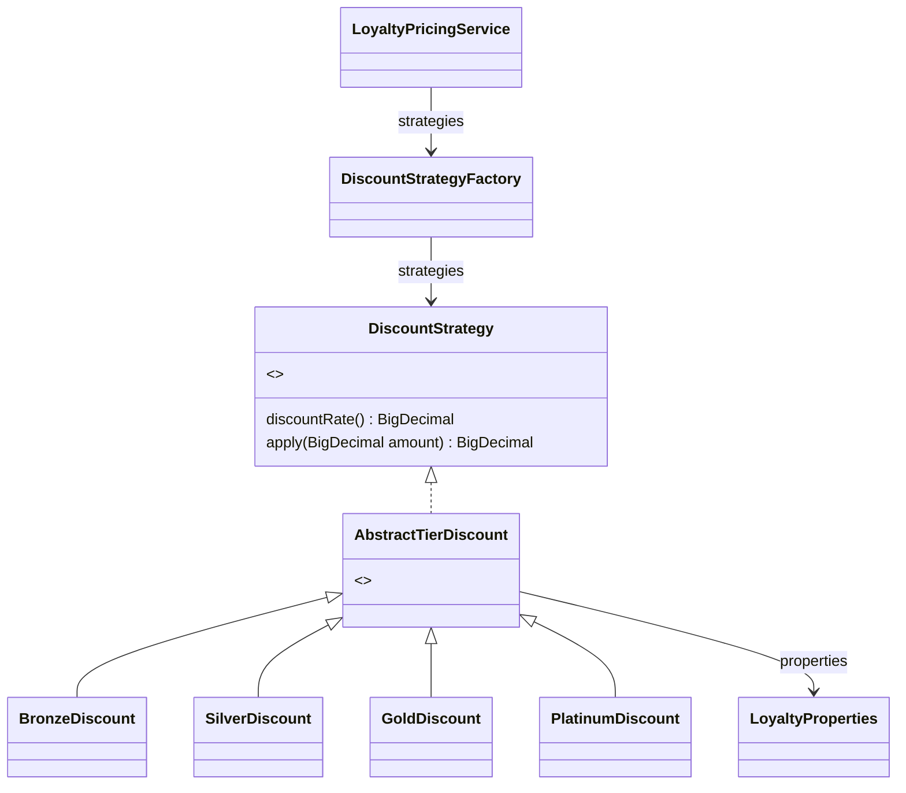
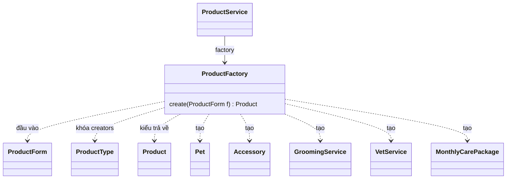

# Sơ đồ lớp PetCare Hub

Đối chiếu mã nguồn ngày 22/11/2026, commit `1598cc754b3e95252fe61bcca8134cf6d0808fcc`. Tên định danh giữ nguyên theo Java; phần giải thích bằng tiếng Việt.

Các khối độc lập: những lớp trùng tên như `CancelledState` thuộc package ghi trong từng mục. Mũi tên nét đứt là phụ thuộc, không phải khóa ngoại; đối tượng State được dựng từ enum, không lưu thành entity. Chỉ trình bày thành viên liên quan đến chủ đề, không liệt kê mọi getter do Lombok sinh. Ký hiệu phương thức được rút gọn; dấu () không khẳng định phương thức Java không có tham số. Chữ ký đầy đủ nằm trong file nguồn dẫn kèm.

## 1. Cây kế thừa Product

`Product` và `ServiceItem` là lớp trừu tượng. Giá gọi qua `calculatePrice()`; `GroomingService` cộng phụ phí, các loại còn lại trả giá gốc. JPA dùng JOINED, kể cả bảng trung gian `service_items`. `MonthlyCarePackage` vừa là sản phẩm bán được vừa cung cấp quyền lợi cho Subscription.

Nguồn: [Product:1](../src/main/java/com/petcare/domain/Product.java#L1), [ServiceItem:1](../src/main/java/com/petcare/domain/ServiceItem.java#L1), [MonthlyCarePackage:1](../src/main/java/com/petcare/domain/MonthlyCarePackage.java#L1).

## 2. State Order — domain.order

Luồng chính PENDING → CONFIRMED → SHIPPING → COMPLETED; PENDING/CONFIRMED có thể hủy. Chỉ hủy từ CONFIRMED hoàn kho. State quyết định chuyển, OrderService xử lý kho và sự kiện trong giao dịch.

Nguồn: [Order:1](../src/main/java/com/petcare/domain/Order.java#L1), [OrderState:1](../src/main/java/com/petcare/domain/order/OrderState.java#L1), [OrderStateFactory:1](../src/main/java/com/petcare/domain/order/OrderStateFactory.java#L1).

## 3. State Appointment — domain.appointment

BOOKED → IN_PROGRESS → DONE; chỉ BOOKED cho hủy. Quy tắc giờ làm việc, trùng lịch và khách hủy trước ít nhất hai giờ nằm ở AppointmentPolicy/AppointmentService, không nằm hết trong State.

Nguồn: [Appointment:1](../src/main/java/com/petcare/domain/Appointment.java#L1), [AppointmentState:1](../src/main/java/com/petcare/domain/appointment/AppointmentState.java#L1), [AppointmentStateFactory:1](../src/main/java/com/petcare/domain/appointment/AppointmentStateFactory.java#L1).

## 4. State VaccinationRecord — domain.vaccination

SCHEDULED → DUE_SOON → OVERDUE theo ngày; có thể đi thẳng từ SCHEDULED tới OVERDUE. Ba State còn hoạt động cho hoàn tất hoặc đổi lịch; COMPLETED là kết thúc. Đổi lịch phân loại lại ngay theo ngày mới. Ngưỡng mặc định bảy ngày, đúng ngày hẹn vẫn DUE_SOON.

Nguồn: [VaccinationRecord:1](../src/main/java/com/petcare/domain/VaccinationRecord.java#L1), [VaccinationState:1](../src/main/java/com/petcare/domain/vaccination/VaccinationState.java#L1), [VaccinationStateFactory:1](../src/main/java/com/petcare/domain/vaccination/VaccinationStateFactory.java#L1).

## 5. State Subscription — domain.subscription

ACTIVE dùng lượt; lượt cuối hoặc quá endDate chuyển EXPIRED. ACTIVE gần hết hạn và EXPIRED có thể gia hạn qua đơn hàng; CANCELLED không hồi sinh. Subscription giữ số lượt/dịch vụ đã chốt. Hoàn lượt do hủy lịch là hành vi riêng restoreUse(), chỉ có thể hồi phục gói hết lượt nhưng chưa quá ngày.

Nguồn: [Subscription:1](../src/main/java/com/petcare/domain/Subscription.java#L1), [SubscriptionState:1](../src/main/java/com/petcare/domain/subscription/SubscriptionState.java#L1), [SubscriptionStates:1](../src/main/java/com/petcare/domain/subscription/SubscriptionStates.java#L1).

## 6. Strategy MatchingStrategy

`MatchingService` nhận danh sách Strategy qua constructor và chọn theo key. Hai thuật toán chia sẻ lọc cứng, chuẩn hóa, giải thích, xếp hạng; khác hook weight(). Kết quả tối đa ba thú cưng, có bản chụp khi người dùng đăng nhập.

Nguồn: [MatchingService:1](../src/main/java/com/petcare/service/MatchingService.java#L1), [AbstractScoreStrategy:1](../src/main/java/com/petcare/service/matching/AbstractScoreStrategy.java#L1).

## 7. Strategy DiscountStrategy

`apply(amount)` trả số tiền phải trả sau giảm, không phải số tiền giảm. Bốn Strategy nhận tỷ lệ từ LoyaltyProperties; LoyaltyPricingService chốt giá và áp dụng voucher riêng. Voucher không được triển khai bằng Decorator.

Nguồn: [DiscountStrategy:1](../src/main/java/com/petcare/domain/discount/DiscountStrategy.java#L1), [DiscountStrategyFactory:1](../src/main/java/com/petcare/domain/discount/DiscountStrategyFactory.java#L1), [LoyaltyPricingService:1](../src/main/java/com/petcare/service/LoyaltyPricingService.java#L1).

## 8. Factory ProductFactory

Đây là Simple Factory dùng registry Map<ProductType, Function<ProductForm, Product>>, không phải họ Abstract Factory. Mỗi creator tạo lớp cụ thể rồi gọi update(form); ProductService gọi create khi thêm sản phẩm.

Nguồn: [ProductFactory:1](../src/main/java/com/petcare/domain/factory/ProductFactory.java#L1), [ProductService:1](../src/main/java/com/petcare/service/ProductService.java#L1).

## Đồng hồ, sự kiện và giao diện

`AppointmentClockConfig.appointmentClock()` dùng giờ Asia/Ho_Chi_Minh. Bean `healthClock` có `defaultCandidate=false`: ngoài demo dùng đồng hồ thực, trong demo dùng `MutableClock`. `DemoDateService.simulate()` chỉ chạy VaccinationScheduler; không giả lập đồng hồ của lịch hẹn, gói tháng hay doanh thu. MutableClock kế thừa java.time.Clock, chia sẻ trạng thái giữa các múi giờ và chỉ công bố ngày sau khi tác vụ thành công.

`LoyaltyEventListener` và `SubscriptionEventListener` nhận OrderCompletedEvent trong giao dịch; lỗi có thể rollback cả đơn, điểm và cấp gói. VaccinationStatusChangedListener chỉ ghi log sau commit. Chi tiết và test ở [patterns.md](patterns.md).

Giao diện hướng A đang dùng `src/main/resources/static/css/petcare.css`, `templates/fragments/layout.html` và các template Thymeleaf. Các bản trong `docs/ui/preview/` chỉ là bản xem trước, không dùng làm bằng chứng nghiệp vụ.
